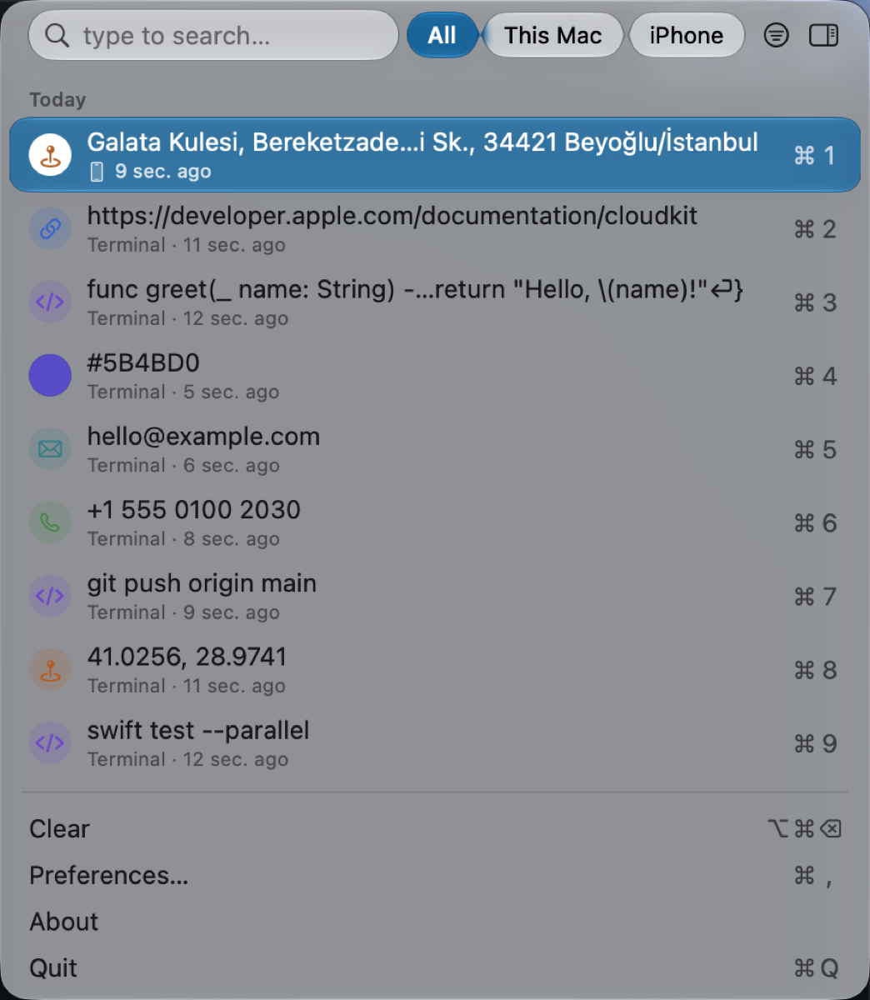
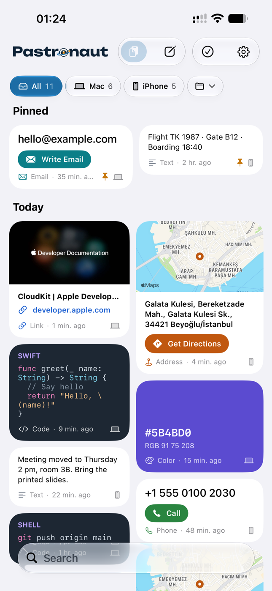
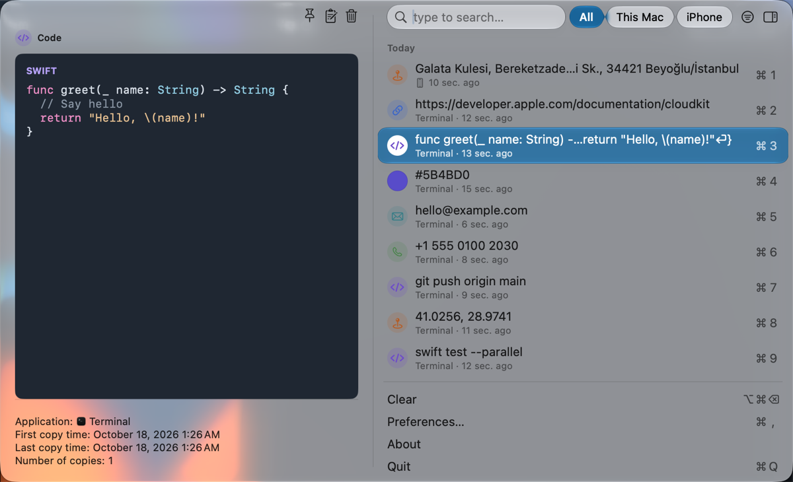
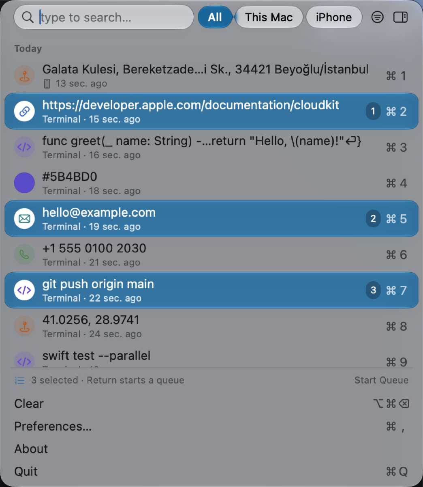
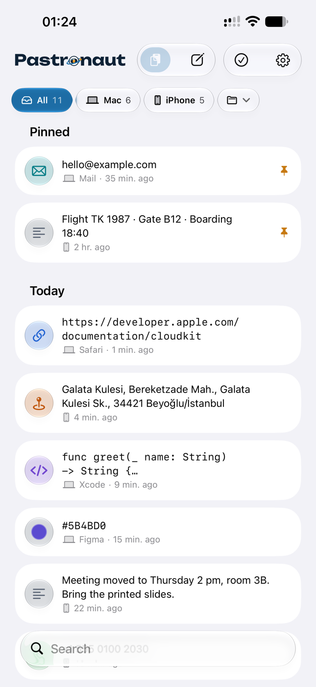
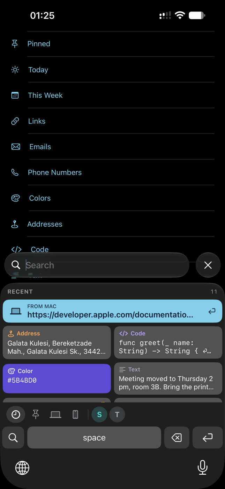
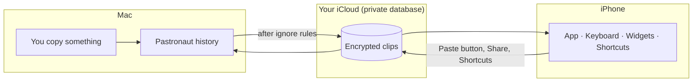

<picture>
  <source media="(prefers-color-scheme: dark)" srcset="docs/brand/pastronaut-wordmark-dark.svg">
  
</picture>

### Copy on your Mac. Paste on your iPhone.

A free, open-source clipboard manager for macOS that brings your history to iPhone and iPad 
through your own iCloud — with a one-tap keyboard, widgets and Shortcuts.

[**Download for Mac**](https://github.com/xkbxyberk/pastronaut/releases/latest) ·
[Website](https://xkbxyberk.github.io/pastronaut/) ·
[Privacy](https://xkbxyberk.github.io/pastronaut/privacy.html) ·
[Türkçe](#türkçe)

 

<picture>
  <source media="(prefers-color-scheme: dark)" srcset="docs/readme/mac-dark.png">
  
</picture>
&nbsp;&nbsp;
<picture>
  <source media="(prefers-color-scheme: dark)" srcset="docs/readme/iphone-cards-dark.png">
  
</picture>

> [!NOTE]
> The Mac app is available now. The iPhone app is on its way to TestFlight and the App Store; until then you can
> build it from source (see [Building](#building)).

## Contents

- [Why Pastronaut](#why-pastronaut)
- [Features](#features) · [Mac](#on-your-mac) · [iPhone and iPad](#on-your-iphone-and-ipad)
- [How it works](#how-it-works)
- [Install](#install)
- [Using it](#using-it)
- [Privacy and security](#privacy-and-security)
- [FAQ](#faq)
- [Building](#building)
- [Credits and license](#credits-and-license)

## Why Pastronaut

- **Your Mac's clipboard, in your pocket.** Everything you copy on the Mac shows up on the iPhone — in the app, in a
  keyboard that types it with one tap, in widgets and in Shortcuts. Copies made on the iPhone come back to the Mac.
- **Private by design.** No accounts, no servers of ours, no analytics. Clips travel through your own private iCloud
  database, with the text end-to-end encrypted.
- **Free and open source.** No subscription, no in-app purchases, MIT licensed. Built on
  [Maccy](https://github.com/p0deje/Maccy), the lightweight clipboard manager for macOS.

## Features

### On your Mac

| | |
|---|---|
| **Fast, keyboard-first history** | <kbd>⇧</kbd><kbd>⌘</kbd><kbd>C</kbd> opens it, type to search, <kbd>Return</kbd> copies, <kbd>⌥</kbd><kbd>Return</kbd> pastes. Everything Maccy does: pins, ignore rules, rich text, images, files. |
| **Knows what you copied** | Colored icons for text, links, code, emails, phone numbers, addresses (Turkish and international, also map coordinates), colors, images and files. |
| **Preview with Space** | A preview that fits the kind: code in color, a color swatch with RGB, and one button to open a link, get directions, write an email or call. |
| **Paste in order** | Select several items (<kbd>⌘</kbd>-click or <kbd>⇧</kbd><kbd>↓</kbd>), press <kbd>Return</kbd>, then each <kbd>⌘</kbd><kbd>V</kbd> anywhere pastes the next one. |
| **Search filters** | `type:link`, `app:Safari`, `date:yesterday`, `from:iphone` — also in Turkish (`tür:`, `uygulama:`, `tarih:`, `cihaz:`). <kbd>⌘</kbd><kbd>G</kbd> shows a found item in the whole history. |
| **This Mac or iPhone** | See everything, or only what came from one device. Items copied on the iPhone carry a small phone mark. |
| **Collections** | Keep snippets, addresses or a project's links together; collections sync too. |
| **Little things** | Pause copying for 15 minutes or an hour, undo a delete with <kbd>⌘</kbd><kbd>Z</kbd>, hide the window while screen sharing, text recognized in images, export and import. |

  <picture>
    <source media="(prefers-color-scheme: dark)" srcset="docs/readme/mac-preview-dark.png">
    
  </picture>
   <b>Space</b> shows a preview that fits the kind — here, code in color.

  <picture>
    <source media="(prefers-color-scheme: dark)" srcset="docs/readme/mac-queue-dark.png">
    
  </picture>
   Select a few items and press <b>Return</b>: each <b>⌘V</b> pastes the next one.

### On your iPhone and iPad

| | |
|---|---|
| **Cards or a list** | Cards by kind with link previews, maps for addresses and colored code — or a compact list like the Mac's. You choose once; previews are optional. |
| **A keyboard for your history** | Switch to the Pastronaut keyboard in any app and tap an item to type it. The latest copy from your Mac waits at the top; tabs for pinned, Mac, iPhone and collections; search with letters and numbers. |
| **Widgets and Control Center** | Recent clips on the Home Screen (also from one collection), the latest clip on the Lock Screen, and a Save Clipboard button in Control Center. |
| **Shortcuts and Siri** | Get Clip, Get Latest Clip, Copy Latest Clip, Get Recent Clips, Save to Pastronaut, Add to Collection. |
| **Saving iPhone copies** | iOS doesn't let apps read the clipboard in the background, so a copy is saved with one tap: open the app, tap Paste in the keyboard, share text to Pastronaut, or use Control Center, Back Tap or the Action button. |
| **Face ID and Spotlight** | Optional Face ID lock; optional Spotlight search for pinned items. |

  <picture>
    <source media="(prefers-color-scheme: dark)" srcset="docs/readme/iphone-list-dark.png">
    
  </picture>
  &nbsp;&nbsp;
  
   The compact list, and the keyboard: the latest copy from your Mac is one tap away.

## How it works

1. The Mac app keeps your history like Maccy does. Items that pass the ignore rules (password managers' concealed
   copies never enter the history) are synced with Apple's CloudKit to the **private** database of your iCloud account.
2. Text, source app and collection names are **end-to-end encrypted**; record names are derived with a key unique to
   your account, so even short texts can't be guessed from them.
3. The iPhone app, its keyboard and widgets read the same history. Copies you save on the iPhone go the other way.

There is no Pastronaut server. If you turn sync off, the Mac app works as a local clipboard manager.

## Install

### Mac

1. Download **Pastronaut.zip** from the [latest release](https://github.com/xkbxyberk/pastronaut/releases/latest),
   unzip it and move **Pastronaut** to Applications. It's signed with Developer ID and notarized by Apple.
2. Open it; a welcome window explains sync and shows a QR code for the iPhone app.
3. To paste directly and to paste in order, allow Pastronaut in **System Settings › Privacy & Security ›
   Accessibility** (called **Device Control and Data Access** on macOS 27).

Updates arrive inside the app (Sparkle, signed).

### iPhone and iPad

Coming to TestFlight and the App Store. To set up the keyboard: **Settings › General › Keyboard › Keyboards › Add New
Keyboard › Pastronaut**, then turn on **Allow Full Access** (it lets the keyboard read your history; nothing you type
is sent anywhere). The app walks you through it.

## Using it

**Mac shortcuts**

| Action | Keys |
|---|---|
| Open the history | <kbd>⇧</kbd><kbd>⌘</kbd><kbd>C</kbd> (changeable) |
| Copy / paste / paste as plain text | <kbd>Return</kbd> / <kbd>⌥</kbd><kbd>Return</kbd> / <kbd>⌥</kbd><kbd>⇧</kbd><kbd>Return</kbd> |
| Pick item 1–9 | <kbd>⌘</kbd><kbd>1</kbd> … <kbd>⌘</kbd><kbd>9</kbd> |
| Preview | <kbd>Space</kbd> (search empty) or <kbd>⌃</kbd><kbd>Space</kbd> |
| Pin / delete / undo delete | <kbd>⌥</kbd><kbd>P</kbd> / <kbd>⌥</kbd><kbd>⌫</kbd> / <kbd>⌘</kbd><kbd>Z</kbd> |
| Select several, start a queue | <kbd>⌘</kbd>-click or <kbd>⇧</kbd><kbd>↑</kbd><kbd>↓</kbd>, then <kbd>Return</kbd> |
| Show a found item in the whole history | <kbd>⌘</kbd><kbd>G</kbd> |
| Pause copying | Right-click the menu bar icon |

**Search filters** (combine them with words to find)

| Filter | Values |
|---|---|
| `type:` · `tür:` | `link`, `code`, `email`, `phone`, `address`, `color`, `text`, `image`, `file` (also Turkish: `bağlantı`, `kod`, `renk`, `adres`, …) |
| `app:` · `uygulama:` | part of the app's name, e.g. `app:safari`, `app:"Google Chrome"` |
| `date:` · `tarih:` | `today`, `yesterday`, `week` (`bugün`, `dün`, `hafta`) |
| `from:` · `cihaz:` | `mac`, `iphone` |

## Privacy and security

- **No data collected.** No analytics, no tracking, no servers of ours. The iPhone app's privacy label is "Data Not
  Collected". Read the [privacy policy](https://xkbxyberk.github.io/pastronaut/privacy.html).
- **Your iCloud only.** Clips live on your devices and in the private CloudKit database of your Apple Account.
- **Encrypted.** Text, source app and collection names use CloudKit's end-to-end encrypted fields.
- **Sensitive copies stay out.** Concealed copies from password managers are never saved. Optionally keep one-time
  codes and card numbers out of sync, or sync only pinned items.
- **Previews are opt-in.** Link and map previews on the iPhone are off until you allow them, and sign-in, reset or
  other one-time-looking links are never opened.

## FAQ

<b>Why can't the iPhone save my copies automatically?</b>

iOS only lets the app in front read the clipboard. Pastronaut saves a copy when you open it (with "Save Clipboard on
Opening"), when you tap Paste in its keyboard, when you share text to it, or with one tap from Control Center, Back Tap
or the Action button. Copies from the Mac always arrive on their own.

<b>Can you read my clips?</b>

No. There is no Pastronaut server; clips go to your own private iCloud database, and their text is end-to-end
encrypted.

<b>Does it work without iCloud?</b>

Yes. The Mac app is a full clipboard manager on its own; sync is just switched off.

<b>Why does the Mac app ask for Accessibility access?</b>

To paste for you (<kbd>⌥</kbd><kbd>Return</kbd>) and to notice <kbd>⌘</kbd><kbd>V</kbd> while you paste a queue.
Keystrokes are not recorded.

<b>Do images and files sync?</b>

Not yet: text, links, code, colors, addresses and the like sync; images and files stay on the Mac.

<b>How is it related to Maccy?</b>

Pastronaut is a fork of [Maccy](https://github.com/p0deje/Maccy) (MIT) that adds iCloud sync, the iPhone app and the
features above. It is not affiliated with Maccy or its author, and it keeps merging Maccy's improvements.

## Building

| | |
|---|---|
| Mac | `xcodebuild -project Maccy.xcodeproj -scheme Maccy -configuration Debug build` (the Swift module is still called `Maccy` to keep merging upstream easy) |
| iPhone | `cd iOS && xcodegen generate`, then build the `Pastronaut` scheme of `iOS/Pastronaut-iOS.xcodeproj` |
| Shared code | `cd PastronautCore && swift test` |

You need Xcode 26 or later and your own Apple Developer team and iCloud container for sync. Design notes (Turkish):
[docs/pastronaut/TASARIM.md](docs/pastronaut/TASARIM.md).

## Credits and license

Pastronaut stands on [Maccy](https://github.com/p0deje/Maccy) by Alex Rodionov — thank you. It also uses
[Sparkle](https://sparkle-project.org), [Defaults](https://github.com/sindresorhus/Defaults),
[KeyboardShortcuts](https://github.com/sindresorhus/KeyboardShortcuts),
[Settings](https://github.com/sindresorhus/Settings),
[LaunchAtLogin](https://github.com/sindresorhus/LaunchAtLogin-Modern),
[Sauce](https://github.com/Clipy/Sauce), [Fuse](https://github.com/krisk/fuse-swift),
[swift-log](https://github.com/apple/swift-log) and [SwiftHEXColors](https://github.com/thii/SwiftHEXColors);
their licenses are listed in the apps. The wordmark uses the [Unbounded](docs/brand/Unbounded-OFL.txt) typeface (SIL OFL).

Released under the [MIT License](LICENSE). Pastronaut is not affiliated with Maccy or Apple.

---

### Türkçe

**Mac'te kopyala, iPhone'da yapıştır.** Pastronaut, Mac'in pano geçmişini kendi iCloud'un üzerinden iPhone ve iPad'e
taşıyan ücretsiz ve açık kaynak bir uygulamadır: Mac'te menü çubuğunda hızlı bir geçmiş; iPhone'da kartlar, tek
dokunuşla yazan bir klavye, widget'lar ve Kestirmeler. Sunucumuz yok, izleme yok; metinler uçtan uca şifreli olarak
yalnızca senin iCloud'unda durur. Uygulama Türkçe ve İngilizce; Türk adreslerini de tanır.
[Mac için indir](https://github.com/xkbxyberk/pastronaut/releases/latest) ·
[Gizlilik politikası](https://xkbxyberk.github.io/pastronaut/privacy.html)
